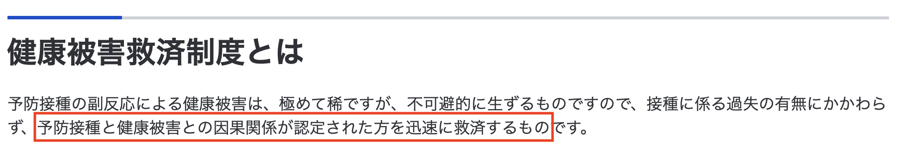
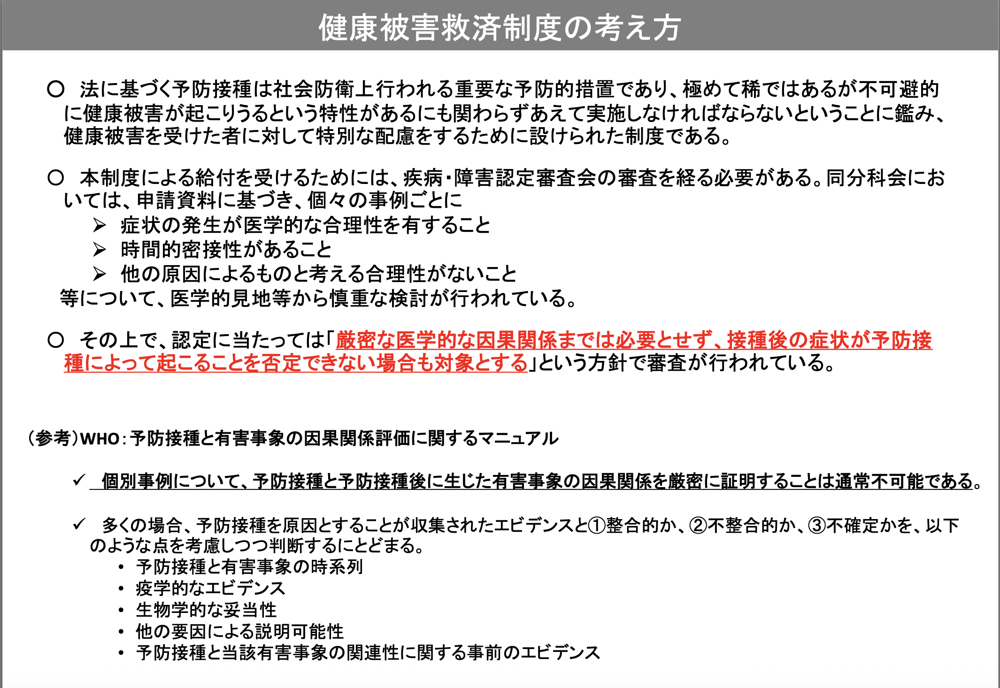
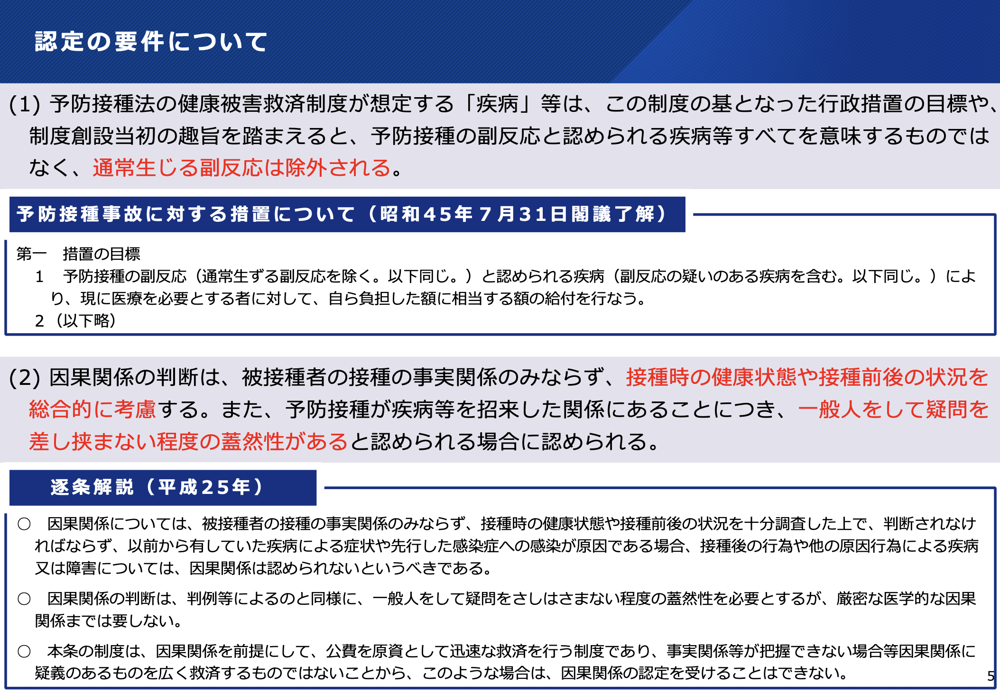

この記事はChatGPTとClaudeの協力のもとで執筆しました。

> **第2版（2026年11月）**
> 第1版では、因果関係を「機序に基づく因果関係」と「蓋然性に基づく因果関係」の二つに分けて対比していました。しかし、機序と頻度の比較は、どちらも因果関係を支える証拠の種類であって、対立するものではありません。第2版では、対比の軸を「自然科学的証明」と「高度の蓋然性」（最高裁のルンバール事件判決の言葉）に改め、全体を書き直しました。救済の基準と裁判の基準の関係、「まだ分かっていない」ことの扱いについての節も加えています。第1版は[こちら（GitHub）](https://github.com/ku-ron/covid-portal-and-notes/blob/efc95e9fa95316eea13d488c393c4a91cdf2bf7c/notes/002_two-types-of-causality-mechanism-vs-probability.md)で読めます。

## はじめに

新型コロナワクチンでは、予防接種健康被害救済制度で認定された件数が、2026年5月25日時点で9,479件、そのうち死亡は1,071件に上ります。

他のワクチンと比べるとどうでしょうか。65歳以上に限り、接種回数がほぼ同じになる期間で比べた集計があります。インフルエンザワクチン（2012〜2021年度の接種、約1億8,000万回）では死亡の認定が4件、新型コロナワクチン（2021〜2023年度の接種、約1億9,000万回）では802件で、接種回数あたりにすると約190倍になります（[藤江さんの集計](https://x.com/JINKOUZOUKA_jp/status/2113161375187193968/photo/4)をもとに筆者が計算。詳細は末尾の補足）。

この比較は、被害の発生頻度をそのまま表すものではありません。救済の申請は、制度の認知度や給付額にも左右されるからです。実際、死亡に対する給付額は、新型コロナ（臨時接種）のほうが高い区分になっています。それでも、「因果関係が認められた」死亡の件数にこれだけの差があることは、軽く見てよいものではないでしょう。

この制度に関する議論の中で、よく使われる言い回しがあります。

> 「厳密な医学的な因果関係までは必要としない」

この「厳密な医学的な因果関係」という言葉が、多くの誤解を生む原因になっているのではないでしょうか。特に、「因果関係が厳密には証明されていないのに救済されている」といった印象が、制度の正当性そのものに対する不信感を生みやすくなっているように感じます。

この記事では、まず公式資料で事実関係を確認します。そのうえで、「厳密な因果関係」という言葉が何を想像させ、実際には何が求められているのかを整理します。

## 公式資料で確認できること

まず、厚労省が公開しているサイトや資料の文言を確認しましょう。

- [予防接種健康被害救済制度について｜厚生労働省](https://www.mhlw.go.jp/stf/seisakunitsuite/bunya/vaccine_kenkouhigaikyuusai.html)

このページの冒頭には、以下のことが書かれています。

> #### 健康被害救済制度とは
>
> 予防接種の副反応による健康被害は、極めて稀ですが、不可避的に生ずるものですので、接種に係る過失の有無にかかわらず、**予防接種と健康被害との因果関係が認定された方を迅速に救済する**ものです。(強調は筆者による)

はっきりと「**因果関係が認定された方を救済する**」と書かれています。これだけでも、よくある「因果関係が認定されていなくても救済されている」という説明は間違いだと分かります。

続いて、その下にある「[健康被害救済制度の考え方(PDF)](https://www.mhlw.go.jp/content/10900000/001017433.pdf)」には、以下の文言があります。

> 「厳密な医学的な因果関係までは必要とせず、接種後の症状が予防接種によって起こることを否定できない場合も対象とする」という方針で審査が行われている。

ここに、冒頭の「厳密な医学的な因果関係までは必要としない」に相当する文章があります。ただ、その上には「**医学的見地等から慎重な検討が行われている**」とも書かれており、その下には「**因果関係評価に関するマニュアル**」も示されています。よく読めば、因果関係の有無を判断したうえで認定していることが分かります。

もう一つ、審査分科会の資料も見ておきます。

- [第145回 疾病・障害認定審査会 感染症・予防接種審査分科会 審議結果 ｜厚生労働省](https://www.mhlw.go.jp/stf/newpage_22632.html)
  - [新型コロナワクチンに係る健康被害救済について(PDF)](https://www.mhlw.go.jp/content/10900000/000864824.pdf)

資料の5ページに「認定の要件について」という説明があります。

> (2) 因果関係の判断は、被接種者の接種の事実関係のみならず、接種時の健康状態や接種前後の状況を総合的に考慮する。また、予防接種が疾病等を招来した関係にあることにつき、一般人をして疑問を差し挟まない程度の蓋然性があると認められる場合に認められる。

ここでも、因果関係の判断をしていることが分かります。

ここまでで、「救済制度で認定されている人は、接種と被害の因果関係が認められた人たちである」ことは確認できました。

では、「厳密な医学的な因果関係」ではない、ということは、判定が緩いということなのでしょうか。以下では、そうではないことを説明していきます。

## 二つの「因果関係の求め方」

鍵になるのは、医療事故をめぐる有名な最高裁判決です。ルンバール事件の判決（昭和50年）で、最高裁は、裁判で因果関係を認めるための基準を次のように述べました。

> 訴訟上の因果関係の立証は、一点の疑義も許されない自然科学的証明ではなく、経験則に照らして全証拠を総合検討し、特定の事実が特定の結果発生を招来した関係を是認しうる高度の蓋然性を証明することであり、その判定は、通常人が疑を差し挟まない程度に真実性の確信を持ちうるものであることを必要とし、かつ、それで足りるものである。
>
> （[最高裁 昭和50年10月24日判決](https://www.courts.go.jp/assets/hanrei/hanrei-pdf-54204.pdf)）

この判決は、因果関係の求め方を二つに分けています。

| | 自然科学的証明 | 高度の蓋然性 |
|:--|:--|:--|
| 判決の言葉 | 一点の疑義も許されない | 通常人が疑いを差し挟まない程度の確信 |
| 何をするものか | 証明する | 判断する |
| 時間 | いつまでも待てる | 今ある証拠で決める |

「厳密な医学的な因果関係」という言葉が想像させるのは、左側の「一点の疑義も許されない自然科学的証明」でしょう。そして裁判が求めているのは、右側の「高度の蓋然性」です。

ここで、先ほどの公式資料を並べてみてください。

- 救済制度の「**厳密な医学的な因果関係までは必要とせず**」は、判決の「**一点の疑義も許されない自然科学的証明ではなく**」に対応しています。
- 審査分科会の「**一般人をして疑問を差し挟まない程度の蓋然性**」は、判決の「**通常人が疑を差し挟まない程度に真実性の確信**」とほぼ同じ言い回しです。

つまり救済制度は、裁判と同じく、自然科学的証明までは求めない一方で、高度の蓋然性は求めている、という構造になっています。「厳密な因果関係は必要としない」と聞くと緩い基準に聞こえますが、実際には、裁判で因果関係を認めるときと同じ考え方に立っているのです。

## 一点の疑いもない証明は、科学自身も持っていない

ここで、もう一歩踏み込んでみます。そもそも「一点の疑義も許されない自然科学的証明」とは、何なのでしょうか。

科学の知見は、常に暫定的なものです。どれほど確かに見える知見も、新しい証拠によって書き換えられる可能性があります。人体のように複雑で個人差の大きいものについてはなおさらで、機序がある程度分かっていても、すべての要素が明らかになっているとは限りません。判決の「一点の疑義も許されない自然科学的証明」は、対比のために置かれた理想としての証明であって、実際の科学がそのような証明を手にしていることは、ほとんどありません。

だとすれば、「厳密な因果関係が証明されていないのだから、救済はおかしい」という批判は、科学自身も満たしていない基準を、被害を受けた人に求めていることになります。

裁判も救済制度も、科学が最終的な答えを出すのを待つことはできません。今ある証拠で判断しなければならないのです。だからこそ、求められるのは証明ではなく、高度の蓋然性による判断なのです。

## 高度の蓋然性は、どうやって判断されるのか

では、「通常人が疑いを差し挟まない程度」の判断は、具体的にどう行われるのでしょうか。

### 問われていることは二つある

「因果関係」という言葉で問われていることは、実は二つあります。

- **一般的な因果関係**：このワクチンは、この症状を起こしうるのか
- **個別の因果関係**：この人のこの症状は、このワクチンによって起きたのか

救済制度で判断されるのは、後者の個別の因果関係です。ただし、個別の判断は前者を土台にしています。

### 一般的な因果関係を示す、二種類の証拠

「このワクチンはこの症状を起こしうるか」を示す証拠には、大きく分けて二種類あります。

- **機序（メカニズム）**：ワクチンの成分が体内でどう働き、どういう経路で症状に至るのかを説明するもの。
- **頻度の比較**：接種した人としていない人、あるいは同じ人の接種直後とそれ以外の時期で、症状が起きる頻度を比べるもの。疫学的な証拠と呼ばれます。

医学では機序による説明が重視されがちです。しかし、機序が分からなくても、頻度の比較で因果関係が確かめられることは珍しくありません。喫煙と肺がんの関係は、その仕組みが解明されるより先に、疫学的な比較で確かめられました。mRNAワクチン後の心筋炎も、機序がはっきりしないうちから、頻度の比較で確認されています。

逆に、もっともらしい機序があっても、頻度を比べて差が出なければ、因果関係は疑わしくなります。理想は両方がそろうことですが、どちらか一方だけが「厳密」というわけではありません。二つは互いに補い合う証拠です。

### 個別の判断は「最もよい説明」を選ぶ推論

一般的な因果関係が分かっていても、それだけで「この人のこの症状はワクチンによる」とは言えません。その症状は、ワクチンと関係なく起きることもあるからです。そこで、次のようなことを総合して判断します。

- その症状は、ワクチンで起こりうるものか（一般的な因果関係）
- 接種から発症までの時間の経過は、典型的なものか
- ほかに考えられる原因はないか。あれば、それを除外できるか

このように、いくつかの説明の候補から最も筋の通るものを選ぶ推論を、「アブダクション」（最良の説明への推論）と呼びます。医師が日常的に行っている鑑別診断も、同じ形の推論です。特別に緩い推論ではなく、医療の現場で標準的に使われている推論です。

なお、ここでいう「蓋然性」とは、「その判断がどれくらい確からしいか」という確信の度合いのことです。因果関係そのものが確率的だ、という意味ではありません。

## 「まだ分かっていない」は「関係がない」ではない

ここで注意が必要なのは、一般的な因果関係について、「まだ分かっていない」という状態がよくあることです。

- **機序が解明されていない。** まれな副反応ほど仕組みの研究は進みにくく、解明されないまま終わることもあります。
- **頻度の比較がない、または足りない。** まれな副反応では、調査そのものが行われていなかったり、行われていても人数が少なすぎて差を検出できなかったりします。

この二つは、どちらも「証拠がまだない」状態であって、「関係がないという証拠がある」状態ではありません。前者を後者のように扱って認定を退ければ、科学がまだ追いついていないことの不利益を、被害を受けた本人に負わせることになります。

これは救済制度の趣旨にも反します。冒頭で見たとおり、救済制度は、予防接種による健康被害は「不可避的に生ずる」ものだという前提に立ち、過失の有無を問わずに救済する仕組みです。人類の知識がまだ及んでいないという事情も、その「避けられなさ」の一部と考えるのが自然でしょう。

ただし、区別しておくべきことがあります。

- **調べていない、調べきれていない**（機序が未解明、調査がない、人数が足りず差を検出できない）ことは、認定を退ける理由にすべきではありません。
- **十分に調べて、否定的な結果が出た**（十分な規模で比べて差がなかった、機序として起こりえないことが確かめられた）ことは、因果関係を否定する方向の、本物の証拠です。

二つは、どちらも「因果関係を示す結果が出ていない」という点で似て見えますが、意味はまったく違います。「問題を示す証拠がない」ことと「問題がないことが確かめられた」ことは別だ、という点は、[別の記事](./005_spike-protein-review-is-not-safety-evidence.md)でも扱いました。

また、一般的な因果関係が分かっていないからといって、何でも認定してよいわけでもありません。その場合には、個別の事情、つまり時間の経過が典型的か、ほかの原因を除外できるかが、判断のより大きな部分を担うことになります。

### 「否定できない場合も対象とする」について

公式資料には、「否定できない場合も対象とする」という言い回しもありました。文字どおりに読めば、「疑いを差し挟まない程度」より低い水準にも読めます。

一つの読み方として、この言い回しは、上で見た「まだ分かっていない」状態、つまり一般的な因果関係について科学が肯定も否定もできない場合に、それを理由に退けない、という趣旨だと考えることもできます。ただ、二つの文言が審査の中で実際にどう使い分けられているのかは、公開されている資料からは確定できません。

## まとめ

タイトルの問いに戻りましょう。「厳密な因果関係」とは何だったのでしょうか。

救済制度の資料にある「厳密な医学的な因果関係」とは、ルンバール判決の言う「一点の疑義も許されない自然科学的証明」のことでした。救済制度が「必要としない」と言っているのは、この意味での因果関係です。一方で、救済制度は「因果関係の認定」そのものを放棄しているわけではありません。求めているのは、「高度の蓋然性」による因果関係の判断です。

| | 自然科学的証明 | 高度の蓋然性 |
|:--|:--|:--|
| 救済制度の資料での言葉 | 「厳密な医学的な因果関係」（必要としない） | 「因果関係が認定された方を救済」「一般人をして疑問を差し挟まない程度の蓋然性」 |
| 求めるもの | 一点の疑いもない証明 | 通常人が疑いを差し挟まない程度の確信 |
| 実際に手にできるか | 科学自身もほとんど持っていない | 今ある証拠を総合して判断できる |
| 使われる場面 | （理想としての証明） | 裁判、救済制度の審査 |
| 判断の材料 | ― | 機序の説明、頻度の比較、時間の経過、ほかの原因の除外 |

「厳密な因果関係」という言葉は、一点の疑いもない科学的証明を想像させます。しかし、そうした証明は、裁判でも救済制度でも求められていませんし、科学自身もほとんど手にしていません。求められているのは、利用できる証拠を総合して、通常人が疑いを差し挟まない程度に確からしい判断をすることです。

また、機序が解明されていないことや、調査がまだないことは、「関係がない」ことを意味しません。科学がまだ追いついていないことの不利益を、被害を受けた人に負わせるべきではないでしょう。

この点を押さえておけば、「厳密な因果関係が証明されていないのに救済されている」という印象は誤解だと分かるのではないでしょうか。

---

## 補足：救済認定数の比較について

### 新型コロナワクチン全体の認定件数

2026年5月25日時点で、新型コロナワクチン（特例臨時接種）の救済制度の実績は、進達受理15,356件、認定9,479件、否認4,659件です。死亡一時金または葬祭料に係る認定は1,071件です（厚労省の審議結果を集計した[吹田市のページ](https://www.city.suita.osaka.jp/kenko/1018600/1018228/1028847.html)による）。

### 65歳以上での比較

| | 接種回数（65歳以上） | 死亡の認定 | 100万回あたり |
|:--|:--|:--|:--|
| インフルエンザ（2012〜2021年度の接種） | 179,221,430回 | 4件 | 約0.022件 |
| 新型コロナ（2021〜2023年度の接種） | 193,362,873回 | 802件 | 約4.1件 |

- 死亡の認定件数は、厚労省が審査会ごとに公表している認定結果をもとにした[藤江さんの集計](https://x.com/JINKOUZOUKA_jp/status/2113161375187193968/photo/4)によります。
- インフルエンザの接種回数は、厚労省「[定期の予防接種実施者数](https://www.mhlw.go.jp/topics/bcg/other/5.html)」の2012〜2021年度の実施人員の合計です。
- 新型コロナの接種回数は、首相官邸の公表値（2024年3月19日公表分まで）です。
- 100万回あたりの件数と、その比（約190倍）は筆者の計算です。藤江さんの集計で使われている接種回数とは少し異なる可能性がありますが、桁の違いという結論には影響しません。

### 給付額の違い

救済制度の給付額は、接種の区分によって違います。現在の給付額（2026年4月改訂）は次のとおりです（[厚生労働省「予防接種健康被害救済制度について」](https://www.mhlw.go.jp/stf/seisakunitsuite/bunya/vaccine_kenkouhigaikyuusai.html)）。

| 給付 | A類疾病の定期接種・臨時接種 | B類疾病の定期接種 |
|:--|:--|:--|
| 死亡に対する給付 | 死亡一時金 4,950万円 | 遺族年金 年274万8,000円（10年が限度）、または遺族一時金 824万4,000円 |
| 障害年金（1級、年額） | 565万6,800円 | 314万2,800円 |
| 葬祭料 | 22万2,000円 | 22万2,000円 |

2024年3月までの新型コロナワクチンの接種は、すべて「特例臨時接種」として行われたので、A類疾病・臨時接種の区分で救済されます。一方、高齢者のインフルエンザワクチンはB類疾病の定期接種です。なお、2024年4月以降の新型コロナワクチンの定期接種（65歳以上など）は、B類疾病の区分になりました。

給付額が高いほど、申請する動機も強くなると考えられます。上の比較の差の一部は、この給付額の違いで説明できるかもしれません。ただ、死亡は給付額にかかわらず申請の動機が比較的強い事象でもあり、約190倍という差のすべてを給付額の違いで説明するのは難しいでしょう。

