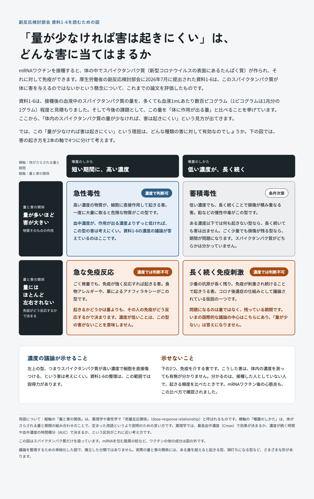

2026年10月9日の参議院本会議にて、参政党の神谷宗幣議員からの代表質問として、コロナmRNAワクチンの安全性について、米国で方針が変わったが日本ではどう考えているのか、という質問がありました。それに対して上野賢一郎厚生労働大臣が、以下のように答えているようです(議事録が上がったらリンクを追加します)。

> 「厚生労働省の研究班でも米国が根拠とした主な論文を精査し、直接的な安全性上の問題を示す文献の存在は確認できないとされております。」

その「論文を精査した」というのが、「第112回厚生科学審議会予防接種・ワクチン分科会副反応検討部会」の「新型コロナワクチン由来スパイクタンパク質の安全性上の懸念に関する文献評価」のことだとすると、これはワクチンの安全性を保証するものでは全くありません。

- [第112回厚生科学審議会予防接種・ワクチン分科会副反応検討部会、令和8年度第4回薬事審議会医薬品等安全対策部会安全対策調査会（合同開催）　資料](https://www.mhlw.go.jp/stf/shingi2/newpage_00295.html)
    - [資料１－６ 新型コロナワクチン由来スパイクタンパク質の安全性上の懸念に関する文献評価について（齊藤参考人提出資料）(PDF)](https://www.mhlw.go.jp/content/11120000/001727304.pdf)

## この研究が調べたもの

この研究は、「ワクチン由来のスパイクタンパク質が体内で見つかった」と報告した論文を集め、それらを分析的妥当性（測定の信頼性）と因果推論の設計（比較対照の有無やバイアス）の両面から評価し、信頼できるかを調べたものです。結論は、害との関係を信頼できる形で示した論文はない、というものでした。

ただ、これはワクチンが安全だと確かめた研究ではありません。理由は二つあります。

### 理由1：調べたのはスパイクタンパク質だけ

一つは、調べたのがスパイクタンパク質だけだということです。mRNAワクチンは、スパイクタンパク質の設計図にあたるmRNAを、脂質でできた小さな粒（脂質ナノ粒子）に包んで注射するものです。体に入るのは、設計図のmRNA、それを包む脂質の粒、製造工程に由来する微量の成分などになります。そしてmRNAからは、体内でスパイクタンパク質が作られます。

副反応の原因になりうるものは、このうちのどれでもありえます。今回の研究は、このうちスパイクタンパク質とその設計図のmRNAが体の中で見つかったものについてのみ調べたもので、ワクチン全体の安全性を調べたものではありません。

### 理由2：副反応は「頻度の比較」で分かる

もう一つは、ワクチンの副反応はふつう、体の中で原因物質を見つけることで分かるのではなく、疫学的調査によって分かるということです。
機序が分からなくても、接種した人としていない人、あるいは同じ人の接種直後とそれ以外の時期で、有害事象が起きる頻度を比べることで、有害事象が増えていることは確認できます。

実際、mRNAワクチンで心筋炎が起きやすくなることは、疫学的調査によって確認されました。今回の研究の調べ方では、すでに確認されている心筋炎ですら捉えられません。

- 例：イスラエルで接種者と未接種者を約88万人ずつ比べた研究
    - [Barda N, et al. Safety of the BNT162b2 mRNA Covid-19 Vaccine in a Nationwide Setting. NEJM 2021](https://www.nejm.org/doi/full/10.1056/NEJMoa2110475)

## 報告書の「否定しきれず」がスライドから消えている

スライドの元となる研究報告書には「**有害事象との関連性について可能性は否定しきれず**」と書かれています。しかし部会のスライドにはこの一文がありません。そして国会では「問題を示す文献はない」という部分だけが、安全性の根拠のように使われているように見えます。

- [新型コロナワクチンの安全性に係る研究｜厚生労働科学研究成果データベース](https://mhlw-grants.niph.go.jp/project/180751)
    - [総括研究報告書 新型コロナワクチンの安全性にかかる研究／国立医薬品食品衛生研究所　齊藤公亮(PDF)](https://mhlw-grants.niph.go.jp/system/files/report_pdf/202506048A-sokatsurv.pdf)

副反応検討部会のページはこちらです。開催一覧の第112回（令和8年7月24日）から、資料と議事録を確認できます。

- [厚生科学審議会（予防接種・ワクチン分科会 副反応検討部会）｜厚生労働省](https://www.mhlw.go.jp/stf/shingi/shingi-kousei_284075.html)

齊藤参考人の口頭説明も、安全と断定してはいませんが、「否定しきれず」には触れていません。

つまり、研究班自身は「安全である」とは結論づけておらず、「有害事象との関連の可能性は否定しきれない」という留保を付けていました。ところが、その留保は部会のスライドの段階で抜け落ち、国会答弁では「問題を示す文献はない」という部分だけが残りました。研究の結論が、伝えられる過程で少しずつ「安全性の根拠」へと変わっていったように見えます。

## まとめ：「問題を示す証拠がない」と「問題がない」は別のこと

ここまでの話を整理すると、次のようになります。

- 研究班が評価したのは、**ワクチン由来のスパイクタンパク質（とmRNA）が体内で見つかったと報告した論文**に限られる
- 結論は、それらの論文の中に**害との関係を信頼できる形で示したものはない**というもので、報告書自身も**「否定しきれず」**と留保を付けている
- 副反応はふつう**疫学的な比較**で見つかるものであり、この研究の調べ方では、すでに確認されている心筋炎ですら捉えられない

「問題を示す信頼できる証拠が見つからなかった」ことと、「問題がないことが確かめられた」ことは、まったく別のことです。この研究が示したのは前者の、しかも限られた範囲についてだけです。

したがって、この文献評価を、米国の方針転換に対する「日本では安全性に問題はない」という回答の根拠として使うのは、研究の結論の範囲を超えた使い方だと言わざるを得ません。(ただし、大臣の答弁が指しているものが別の研究報告である可能性は残っています)

ワクチンの安全性を説明するのであれば、研究の範囲と留保をそのまま示したうえで、接種後の有害事象の頻度を比べた疫学的なデータなど、安全性を直接確かめられる根拠に基づいて説明するべきではないでしょうか。

---

## 補足：「量が少なければ害は起きにくい」は、どんな害に当てはまるか

資料1-6は、接種後の血液中のスパイクタンパク質の量を、多くても血液1mLあたり数百ピコグラム（1ピコグラムは1兆分の1グラム）程度と見積もりました。そして今後の課題として、この量を「体に作用が出る量」と比べることを挙げています。ここから、「体内のスパイクタンパク質の量が少なければ、害は起きにくい」という見方が出てきます。

では、この「量が少なければ害は起きにくい」という理屈は、どんな種類の害に対して有効なのでしょうか。害の起き方を、次の2つの軸で4つに分けて考えてみます。

- **曝露のしかた**：短い期間に高い濃度でさらされるのか、低い濃度が長く続くのか
- **量と害の関係**：量が多いほど害が大きいのか（物質そのものの作用）、量にはほとんど左右されないのか（免疫がどう反応するかで決まる）

| 量と害の関係 ＼ 曝露のしかた | 短い期間に、高い濃度 | 低い濃度が、長く続く |
|---|---|---|
| **量が多いほど害が大きい** | 急性毒性 → **濃度で判断できる** | 蓄積毒性 → 条件次第 |
| **量にはほとんど左右されない** | 急な免疫反応 → **濃度では判断できない** | 長く続く免疫刺激 → **濃度では判断できない** |

それぞれの型は次のようなものです。

- **急性毒性**
  - 高い濃度の物質が、細胞に直接作用して起きる害。一度に大量に取ると危険な物質がこの型です。
  - 血中濃度が、作用が出る濃度よりずっと低ければ、この型の害は考えにくい。資料1-6の濃度の議論が答えているのはここです。
- **蓄積毒性**
  - 低い濃度でも、長く続くことで損傷が積み重なる害。鉛などの慢性中毒がこの型です。
  - ある濃度以下では何も起きない型なら、長く続いても害は出ません。ごく少量でも損傷が残る型なら、期間が問題になります。スパイクタンパク質がどちらかは分かっていません。
- **急な免疫反応**
  - ごく微量でも、免疫が強く反応すれば起きる害。食物アレルギーや、薬によるアナフィラキシーがこの型です。
  - 起きるかどうかは量よりも、その人の免疫がどう反応するかで決まります。濃度が低いことは、この型の害がないことを意味しません。
- **長く続く免疫刺激**
  - 少量の抗原が長く残り、免疫が刺激され続けることで起きうる害。コロナ後遺症の仕組みとして議論されている仮説の一つです。
  - 問題になるのは量ではなく、残っている期間です。国際的にも議論されているのはこの点で、「量が少ない」だけでは答えになりません。

### 濃度の議論が示せること・示せないこと

**示せること**：表の左上の型、つまりスパイクタンパク質が高い濃度で細胞を直接傷つける、という害は考えにくい。資料1-6の整理は、この範囲では説得力があります。

**示せないこと**：表の下の2つ、免疫を介する害です。こうした害は、体内の濃度を測っても有無が分かりません。分かるのは、接種した人としていない人で、起きる頻度を比べたときです。mRNAワクチン後の心筋炎も、この比べ方で確認されました（本文の「理由2」）。

### この表についての注意

- 縦軸の「量と害の関係」は、薬理学や毒性学で「用量反応関係」（dose-response relationship）と呼ばれるものです。横軸の「曝露のしかた」は、体がさらされる量と期間の組み合わせのことで、定まった用語というより説明のための言い方です。薬理学では、最高血中濃度（Cmax）で効果が決まるか、濃度が続く時間や血中濃度の時間積分（AUC）で決まるか、という区別がこれに近い考え方です。
- この表はスパイクタンパク質だけを扱っています。mRNAを包む脂質の粒など、ワクチンの他の成分は表の外です（本文の「理由1」）。
- 議論を整理するための単純化した表で、確立した分類ではありません。実際の量と害の関係には、ある量を超えると起きる型、頭打ちになる型など、さまざまな形があります。

この補足の内容を1枚の図にまとめたものです。

